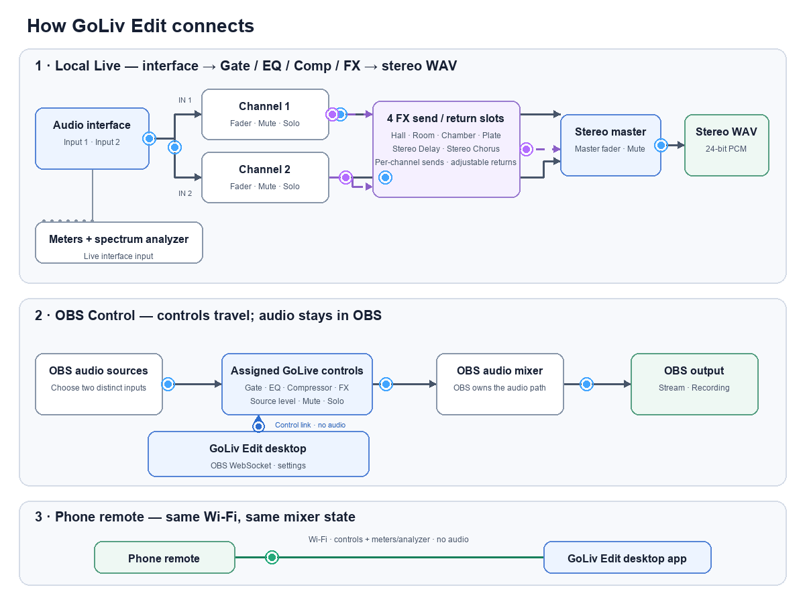

# GoLiv Edit

### Your sound, in your hands.

**A complete creative mixing surface for the people behind the sound.** Shape two inputs with gate, EQ, compression, and send-based effects. Build a stereo mix, record locally, or take your channel controls into OBS. Then step away from the desk and keep mixing from your phone.

[**Get GoLiv Edit**](https://github.com/Parker-009d/GoLive-Edit/releases/latest) · [Visit the official website](https://parker-009d.github.io/GoLive-Edit/) · [See what it can do](#made-for-the-moment-the-sound-needs-you) · [See all the connections](#how-the-connections-work)

---

## More feel. More space. More control.

A voice that needs warmth. A keyboard that needs room. A performance that deserves more than a dry signal.

In the tested macOS app, GoLiv Edit puts the sound-shaping tools in one focused surface. Sculpt each channel with a noise gate, four-band parametric EQ with low cut, and a compressor. Add depth with four assignable FX slots, each with channel sends and a return in the mix. Bring it all together on the stereo master, with clear meters and a live spectrum analyzer to help you follow what is happening.

Use it for a vocal and keys, a two-mic session, a podcast, rehearsal, or a small live setup. Connect a compatible audio interface; GoLiv Edit is built around the sound coming from your gear, not one particular interface brand.

## Made for the moment the sound needs you

- **Two channels. One coherent mix.** Keep your sources separate while shaping and balancing them together into a stereo master.
- **A real channel strip, ready to shape.** Use a noise gate to manage unwanted room sound, four-band parametric EQ and low cut to shape tone, and a compressor to steady dynamics. Each processor is adjustable per channel.
- **Four FX sends. Six flavors of space and motion.** Build a sound with Hall, Room, Chamber, or Plate Reverb, Stereo Delay, or Stereo Chorus. Send each channel to the effects you choose, balance the returns, and blend the wet sound into your stereo mix.
- **Start inspired, finish by ear.** Vocal and keyboard presets give you a useful first move; the controls are there to make the sound yours.
- **See what you hear.** Follow channel meters and the spectrum analyzer as the sound changes.
- **Record the performance, not a pile of setup steps.** Capture a stereo WAV mix locally in Local Live.
- **Take the desk with you.** Pair a phone on the same Wi-Fi network to adjust supported mixer controls from across the room. Audio stays on the computer; the phone is a control surface.
- **Bring your mix workflow to OBS.** Connect over OBS WebSocket, assign sources to channels, and control the mapped audio from the mixer.
- **Keep a clear hand on the master.** Channel mute controls that channel; Main mute silences the full mix.

## Two ways to work, one familiar mixer

### Local Live — make the mix, even with OBS closed

Choose your interface, set your channel levels, shape the sound, route FX, and record the processed stereo mix as a WAV. Local Live is for the room, rehearsal, practice, podcast, or performance where you want the mixer to be the whole setup.

### OBS Control — keep your audio controls close to the stream

Connect to OBS Studio using its WebSocket server and map an OBS audio input to each channel. Use GoLiv Edit to manage the assigned sources and available stream controls from one surface. OBS remains responsible for the stream itself.

## How the connections work

This animated diagram shows how audio and control data move through the whole app. The moving dots follow the signal; dashed lines show control or meter data.

### Follow each path

- **Local Live recording:** Choose your interface and save location. Input 1 feeds Channel 1 and input 2 feeds Channel 2. Each lane runs through Gate → parametric EQ → compressor → assigned FX send and wet return → channel fader and mute/solo. Both lanes join at the stereo master, pass through the soft limiter, and write a 24-bit stereo WAV. The meters and analyzer tap the interface inputs before processing.
- **OBS Control:** Connect to OBS with its WebSocket host, port, and password; assign one OBS source to each channel. GoLiv Edit applies the channel’s Gate, EQ, compressor, and FX controls to the assigned OBS source filters. The audio stays in OBS and then reaches the OBS mixer and stream/recording output. The WebSocket carries control messages, not audio.
- **Phone remote:** Pair the phone and Mac on the same Wi-Fi. Fader and mute/solo changes travel to GoLiv Edit; meter/analyzer data returns to the phone. No audio travels to the phone.
- **Local Live into OBS:** Local Live WAV recording and OBS recording/streaming are separate paths. OBS Control does not automatically route the Local Live mix into OBS; that requires a separate audio input route.

## Shape the sound. Give it space. Make it yours.

Start with a gate for focus, EQ for character, and compression for control. Then choose the space or movement the performance needs: a subtle room, a long hall, a plate sheen, a stereo echo, or a moving chorus. GoLiv Edit gives you four separate FX returns and channel-by-channel sends, so a vocal can sit in a different space from the keys without losing the balance of the mix.

Choose from practical vocal and keyboard starting points, then tailor every setting to the instrument, microphone, performer, and room in front of you. Presets are inspiration—not one-size-fits-all recipes. Your ears stay in charge.

With a phone paired on your local network, you can make a quick adjustment from the recording chair, the other side of the room, or beside the performer. The remote sends control changes and receives meter information; it does not stream audio to your phone.

## Downloads

Choose the build for your device from [GoLiv Edit Releases](https://github.com/Parker-009d/GoLive-Edit/releases/latest), or download the Windows Store edition from [Microsoft Store](https://apps.microsoft.com/detail/9MWPT10ZWLVZ).

| Device | Build | Status |
| --- | --- | --- |
| **Mac** | `.dmg` | Version 0.2.0. Universal Intel and Apple Silicon build; includes Local Live Gate, EQ, compressor, and FX processing. |
| **Windows** · x64 | `.zip` with `GoLivEdit.exe` | Local Live recording includes Gate, EQ, and compressor processing. FX processing and OBS source processor controls are not included in this Windows build. WebView2 Runtime is required. |
| **Windows Store** | Microsoft Store | [GoLive Edit on Microsoft Store](https://apps.microsoft.com/detail/9MWPT10ZWLVZ). This is the published Store listing; package updates are submitted through Partner Center. |

The Windows x64 GitHub package is a self-contained executable. The Windows Store listing is maintained separately, and its Store package can differ from the latest GitHub download while an update is being prepared or certified.

## Get started

1. Download the build for your operating system from [Releases](https://github.com/Parker-009d/GoLive-Edit/releases/latest).
2. Connect your audio interface and choose it in Local Live, or open OBS Control and connect to OBS.
3. Set conservative levels first, then adjust the mix while listening to the actual source.
4. For phone control, keep both devices on the same Wi-Fi network and pair from GoLiv Edit.

## Built for real rooms

GoLiv Edit is for sound engineers, musicians, streamers, and creators who want useful control without turning every session into a routing project. It brings the channel strip, stereo mix, local recording, OBS controls, and remote surface together—so the technology can get out of the way and the sound can take center stage.

**Gate the noise. Shape the tone. Add the space. Own the mix.**

Plug in your interface, bring the channels to life, and make a mix that feels like yours. Go live when you’re ready.

---

### Feedback

Found a problem or have an idea? [Open an issue](https://github.com/Parker-009d/GoLive-Edit/issues) with your operating system, app version, audio interface, and steps to reproduce. Please don’t post passwords, stream keys, or private recordings.

### Created by Alex Parker
© 2026 Alex Parker. GoLiv Edit is an independently created product. Download the official build for your device and use it in your sessions. For partnerships, redistribution, or permission to reuse the source or branding, contact the creator.
