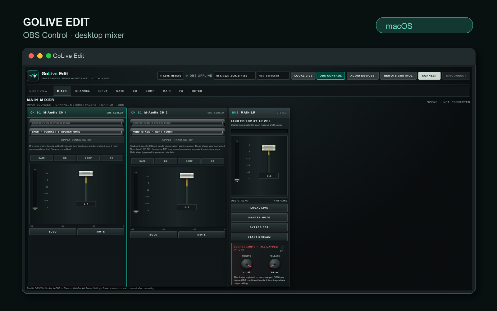
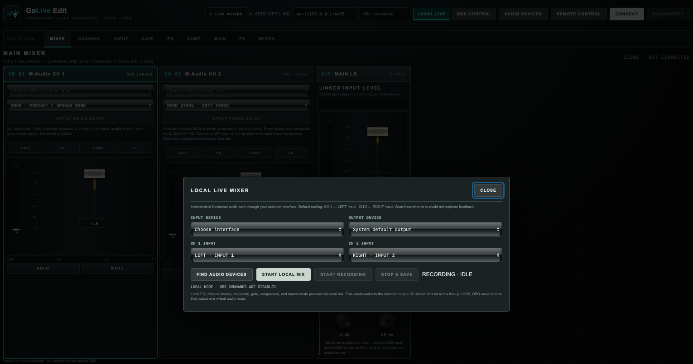
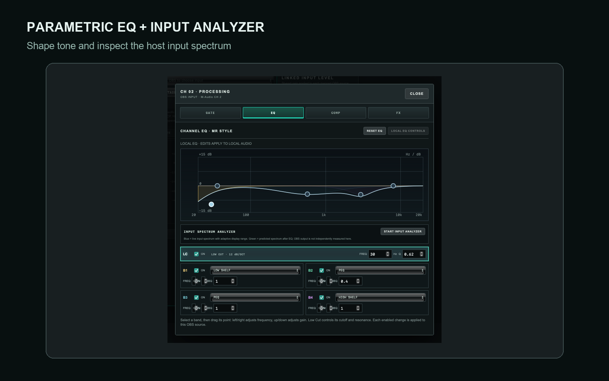
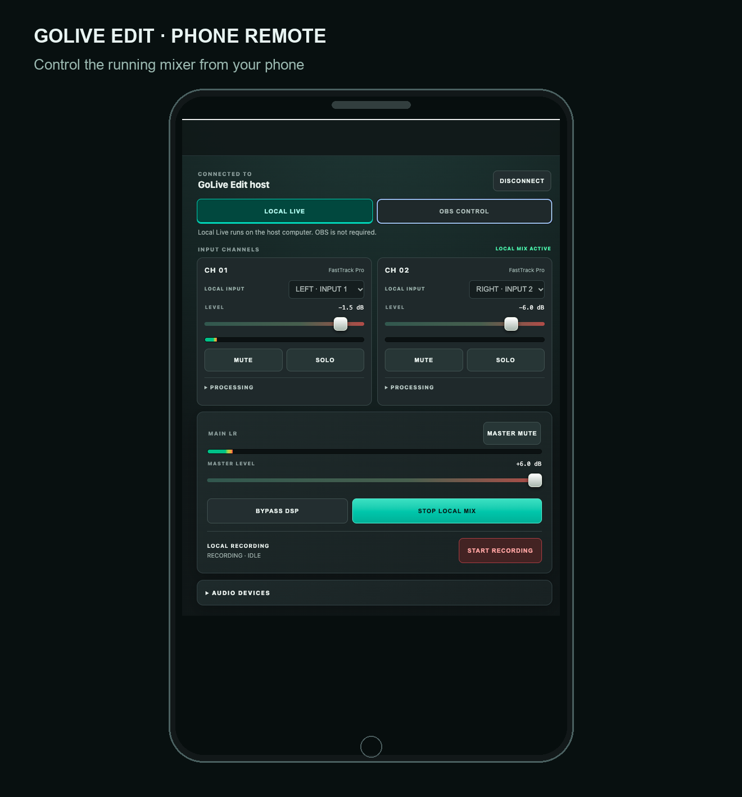
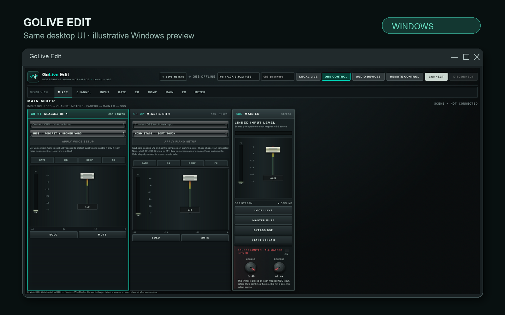

# GoLive Edit

### Your sound. One mixer. OBS when you need it.

**A two-channel desktop mixer for acoustic sessions, podcasts, practice, and live streaming. Mix and record without OBS, connect the same workflow to OBS when you go live, and take control from your phone.**

**LOCAL LIVE · OBS CONTROL · 17 SOUND PRESETS · PHONE REMOTE · LOCAL RECORDING**

GoLive Edit is for the moment when you want to plug in, set your levels, and focus on the performance—not assemble a complicated audio setup. It brings two input channels, live meters, hands-on mixing controls, practical processing, and a stereo master into one desktop app.

Start a session with your audio interface and keep OBS closed. When you need to stream, connect OBS. When you need to move across the room, use your phone as a remote surface for the same running mixer.

## One app, two ways to mix

### Local Live: your session does not need OBS

Connect an audio interface, choose the inputs and output, and build a processed stereo mix in GoLive Edit. Local Live runs independently of OBS, so it works for acoustic practice, a live room, a podcast, or a small performance even when OBS is not installed or open.

Each channel has input trim, a fader, mute and solo, EQ, gate, and compressor controls. A master fader and mute manage the final mix. Live meters show the input and output signal, and DSP bypass lets you compare the processed and unprocessed path. Record the processed stereo mix and save it on your computer.

**Signal path:** audio interface → two channel strips → channel processing and faders → stereo master → selected output and local recording.

### OBS Control: bring the mixer into your stream

When you stream, connect GoLive Edit to OBS Studio over OBS WebSocket and map an OBS audio source to each channel. Adjust the mix and processing from GoLive Edit, monitor the channel and master levels, and use the available OBS stream controls from the same workspace.

GoLive Edit also provides an OBS VST2 filter workflow for compatible plug-ins installed on the host computer. Third-party plug-ins are not bundled with the app; OBS handles the plug-in itself.

Local Live and OBS Control are separate operating modes. Local Live sends audio to the output you select on the host. To send that mix into OBS, set OBS to capture the selected output or a virtual audio route.

## Sound shaping that gets you started

Choose a preset for the source, then adjust it to the instrument, microphone, room, and performer in front of you.

- **17 ready-to-apply presets:** six vocal and microphone presets, including SM58 spoken word, preaching, natural acoustic vocal, warm lead, bright mic, and backing vocal; plus eleven keyboard presets for Nord Stage, Yamaha Motif and CP, Roland RD, Korg Kronos, Kawai MP, electric piano, bright piano, pad, organ, and dense keys.
- **Presets change the processing:** applying a preset loads its EQ, gate, and compressor values into the channel and applies those settings to the active Local Live or OBS path where supported. Presets are practical starting points, not factory calibration or a promise that one setting fits every room and performer.
- **Four-band parametric EQ plus low cut:** shape frequencies across the spectrum with adjustable frequency, gain, Q, and band type. See the combined response curve as you make changes.
- **Live input spectrum analyzer:** inspect the selected host input and compare it with the predicted post-EQ response. The analyzer uses the host audio input; audio is not sent to the phone.
- **Pre-processing input trim:** raise or lower each channel's incoming level before its gate, EQ, and compressor, independently of the channel fader.
- **Seven interface themes:** Deep Teal, Studio Sage, Warm Amber, Slate Blue, Lunar Graphite, Arctic Studio, and Copper Studio. Pick a surface that suits your workspace; the selected theme carries over to Phone Remote.

## Keep control within reach

Pair a phone with the host on the same Wi-Fi network or hotspot. Use the phone to switch between Local Live and OBS Control and operate supported mixer, processing, and EQ controls. The desktop and phone show the same shared mixer state, so a mute, solo, fader, or mode change made on one is reflected on the other.

Pair a new device with the one-time code in GoLive Edit. Once trusted, that device can reconnect after the app restarts without asking you to pair again. The remote connection carries control commands and meter/analyzer data; **it does not carry audio**. Router port forwarding is not required.

## See GoLive Edit

### Desktop mixer · OBS Control

### Local Live setup

### Parametric EQ and analyzer

### Phone Remote

### Windows interface preview

*This Windows image is a presentation preview of the shared desktop interface, not a screenshot captured on a Windows PC.*

## What each release brings

| Release | What it brings |
| --- | --- |
| **v0.1.0 · The Core Mixer** | The original two-channel Local Live and OBS Control workflows, channel processing, local recording, and desktop mixer. |
| **v0.2.0 · The Connected Mixer** | Paired phone control of the same mixer, synchronized control state, remote EQ and analyzer controls, smoother EQ updates, 17 vocal and keyboard starting presets, seven surface themes, input trim, and the refreshed OBS mute/solo synchronization fix. |

The v0.1.0 release remains available in the [release history](https://github.com/Parker-009d/GoLive-Edit/releases). The v0.2.0 update refreshes the existing release and keeps its tag and release page.

## Start your first mix

1. Download GoLive Edit for your computer and open it.
2. Choose **Local Live** for a session without OBS, or **OBS Control** to work with an OBS stream.
3. In Local Live, select your audio interface, input assignments, and output. In OBS Control, connect OBS and map a source to each channel.
4. Set input trim and channel levels. Choose a vocal or keyboard preset if it helps you get close, then refine EQ and dynamics while listening to the actual source.
5. Start your local stereo recording, or use the OBS controls for your stream.
6. For phone control, start Remote Control on the host and pair a phone on the same Wi-Fi or hotspot.

## Downloads and system requirements

- **Windows 10/11, x64:** free Microsoft Store listing or standalone Windows executable. Rust and Cargo are not required to run the standalone build. WebView2 is required and is included with most current Windows installations.
- **macOS Intel, x64:** DMG download. The app is ad-hoc signed and not notarized, so macOS may ask you to approve opening it.
- **Source:** included in the v0.2.0 source-and-downloads archive.

## Questions

**Do I need OBS?** No. Local Live mixes and records without OBS. OBS is needed only for OBS Control and streaming through OBS.

**Does the phone receive my audio?** No. Audio stays on the host computer. The phone sends control changes and receives meter/analyzer data over the local connection.

**Is this a multitrack recording editor?** No. Local Live records the processed stereo mix. GoLive Edit is a live mixer and stereo recorder, not a DAW timeline editor.

**Why does my phone show a certificate warning?** The host creates a private certificate for the local encrypted connection. Continue only for the GoLive Edit address shown on your own trusted network. Keep the pairing code private and leave router port forwarding off.

## Help and feedback

Have a setup question, found a bug, or have an idea that would make GoLive Edit more useful? [Open an issue on GitHub](https://github.com/Parker-009d/GoLive-Edit/issues). Include your operating system, app version, audio interface, and steps to reproduce. Do not post passwords, stream keys, or private recordings.

## Build from source

GoLive Edit uses Tauri 2, Rust, and CPAL. Developer setup requirements are listed in the [Tauri prerequisites](https://v2.tauri.app/start/prerequisites/).

## License

This repository does not currently include a license. Contact the maintainer through GitHub Issues to ask about reuse or redistribution.
